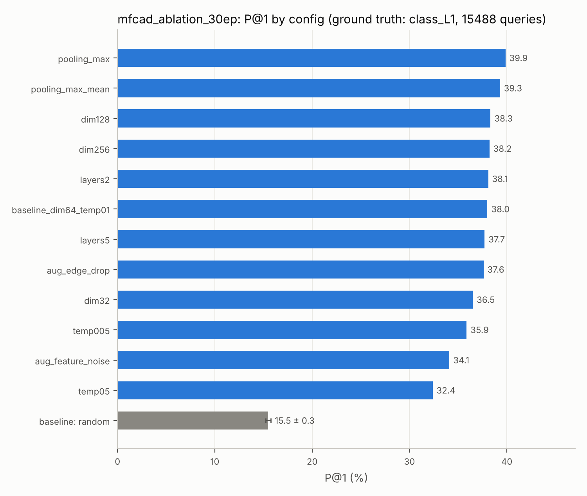

# CAD Model Retrieval via Unsupervised Graph Learning

[](https://www.python.org/downloads/)
[](https://pytorch.org/)
[](https://pytorch-geometric.readthedocs.io/en/latest/)
[](https://github.com/tpaviot/pythonocc-core)
[](https://streamlit.io/)

## 📌 Project Overview
This project presents an end-to-end prototype for **3D CAD Model Retrieval** using unsupervised graph machine learning. Developed as part of the **Software Lab 2026** at the Technical University of Munich (TUM), this pipeline processes boundary representation (B-Rep) CAD data from `.step` files, converts them into Attributed Adjacency Graphs (AAG), and extracts high-dimensional geometric embeddings to find and cluster geometrically similar models.

### ✨ Key Features:
1. **Robust B-Rep Parsing:** Converts raw STEP files to PyTorch Geometric (PyG) graphs using `pythonocc-core`, mapping complex topological entities (Faces/Edges) to graph Nodes and Edges with explicit geometric attributes.
2. **Unsupervised Contrastive Learning:** Trains a GINE (Graph Isomorphism Network) Encoder using InfoNCE loss and graph augmentations (edge dropout, node feature noise) without requiring manually labeled data (SimCLR framework). Architecture choices (pooling strategy, layer depth) and training behavior (augmentation strategy, temperature, embedding size) are all configurable via CLI flags — see [Ablation Study Pipeline](#-ablation-study-pipeline) below.
3. **Fast Similarity Search:** Utilizes the FAISS vector database for millisecond-level cosine similarity retrieval using L2-normalized graph embeddings.
4. **Interactive 3D Web UI:** Features a Streamlit-based dashboard with dynamic STEP-to-Mesh conversion and real-time interactive 3D rendering using `Plotly` and `Trimesh`.
5. **Comprehensive Evaluation & Ablation Studies:** Retrieval is evaluated against three ground truths on MFCAD (file-name class, sub-class, machining-feature histogram) and against 220 hand-labeled Fusion 360 parts, always next to a **random** and a **hand-crafted (non-learned) baseline** (`scripts/evaluate_retrieval.py`). Five design choices are ablated one at a time: embedding dimension, contrastive temperature, pooling strategy, augmentation mode, and GNN layer depth.
6. **Two Datasets:** MFCAD (15,488 parts) and the Fusion 360 Gallery Assembly dataset (15,436 parts), sharing one feature extractor, one model and one training loop.
7. **Reproducible Runs:** every training run writes a `config.json` (all hyper-parameters, seed, feature mode) and a `train_history.json` (loss curve). Index building, evaluation and the web app read the config back, so a checkpoint can never be loaded with the wrong architecture.


## 📂 Repository Structure
```text
cad_retrieval_swl2026/
│
├── data/                        # Data storage (contents ignored by Git)
│   ├── raw_step/mfcad/          # MFCAD .step files
│   ├── raw_step/mfcad_label/    # MFCAD per-face labels (.face_truth), evaluation only
│   ├── raw_step/fusion360/      # Fusion 360 .step files (tools/extract_fusion360.py)
│   ├── processed_graphs/        # Generated PyG .pt graphs (mfcad/, fusion360/)
│   └── fusion360_labels.json    # 220 hand-labeled Fusion 360 parts (tools/labeling_tool.py)
│
├── src/                         # Core pipeline
│   ├── data_converter.py        # Parallel STEP -> B-Rep graph converter (pythonocc)
│   ├── dataset.py               # PyG dataset with model-name tracking
│   ├── features.py              # Raw vs. normalized node/edge features (--features)
│   ├── networks.py              # GINE encoder (mean/max/max_mean pooling) + SimCLR wrapper
│   ├── train_unsupervised.py    # Contrastive training (InfoNCE, augmentations, seeds)
│   ├── retrieval.py             # FAISS index builder + query CLI
│   ├── run_config.py            # config.json save/load, weight loading
│   └── fusion360/               # Fusion 360 entry points (same loop, other defaults)
│       ├── build_fusion360_graphs.py
│       ├── dataset_fusion360.py
│       ├── train_unsupervised_fusion360.py
│       └── retrieval_fusion360.py
│
├── scripts/
│   ├── evaluate_retrieval.py    # Evaluation + random/hand-crafted baselines -> results/
│   ├── plot_results.py          # Bar charts for the report from results/*.json
│   ├── check_duplicates.py      # Real duplicate parts vs. embedding collapse (Fusion 360)
│   ├── evaluate_sweep.py        # Original histogram-metric evaluation (kept for reference)
│   ├── lrz/                     # SLURM jobs for the LRZ AI Systems (see below)
│   └── *.ps1                    # Original Windows sweep scripts used for the 30-epoch ablation
│
├── tools/                       # Dataset helpers
│   ├── extract_fusion360.py     # Pulls STEP files out of the Fusion 360 assembly dataset
│   ├── batch_convert.py         # STEP -> STL (for the labeling tool)
│   └── labeling_tool.py         # Streamlit tool used to label Fusion 360 parts
│
├── checkpoints/                 # Trained weights + FAISS indices (one folder per run)
│   ├── (root)                   # Model served by the MFCAD page of the app
│   ├── fusion360/               # Model served by the Fusion 360 page of the app
│   └── sweep/                   # 12 ablation runs (30 epochs each)
│
├── results/                     # Evaluation tables (.md/.csv/.json) and charts (.png)
├── notebooks/
│   ├── dataset_exploration.ipynb    # MFCAD statistics and class imbalance
│   └── ablation_study_final.ipynb   # Original ablation analysis (histogram metric)
├── tests/                       # pytest suite (synthetic graphs, runs on CPU in seconds)
├── app.py                       # Streamlit web interface
├── README_LRZ.md                # LRZ cluster setup
└── requirements.txt
```


## ⚙️ Installation & Requirements

A Conda environment is **strictly required** to handle the complex C++ backend dependencies of `pythonocc-core`.

```bash
# 1. Create and activate the Conda environment
conda create -n cad_retrieval python=3.12 -y
conda activate cad_retrieval

# 2. Install OpenCASCADE Python bindings (Must be installed via conda-forge)
conda install -c conda-forge pythonocc-core

# 3. Install PyTorch (Adjust the CUDA version based on your GPU, e.g., cu126/cu128)
conda install pytorch torchvision torchaudio pytorch-cuda=12.4 -c pytorch -c nvidia

# 4. Install remaining ML, Graph, and UI dependencies
pip install torch_geometric tqdm faiss-cpu streamlit plotly trimesh pandas scikit-learn matplotlib seaborn
```

> **Note (CPU-only / ARM machines):** `pythonocc-core` is only required for **Step 1** (converting raw `.step` files into graphs). If you already have processed `.pt` graphs and label files, Steps 2–5 below run on plain PyTorch/PyG and work fine CPU-only, including on ARM-based Windows laptops (no CUDA, no `pythonocc-core` needed).


## 🚀 Pipeline & Usage

**Important Execution Rule:** To avoid Python import path errors, always execute the scripts as modules from the project's **root directory** using the `-m` flag.

### Step 1: Data Preprocessing

Place your raw CAD models inside `data/raw_step/mfcad/`. The data converter uses parallel processing to parse topological and geometric features into PyG `.pt` files.

```bash
python -m src.data_converter --input ./data/raw_step/mfcad --output ./data/processed_graphs/mfcad
```

### Step 2: Unsupervised Model Training

Train the GINE encoder using graph augmentations and contrastive learning. The script saves the best checkpoint automatically.

```bash
python -m src.train_unsupervised --data_dir ./data/processed_graphs/mfcad --epochs 100 --batch_size 32
```

*(Tip: Training can be safely interrupted at any time using `Ctrl+C`, and the best checkpoint will be preserved).*

**Available training flags:**

| Flag | Default | Description |
|---|---|---|
| `--epochs` | `100` | Number of training epochs |
| `--batch_size` | `32` | Batch size |
| `--lr` | `1e-3` | Learning rate |
| `--hidden_dim` | `128` | GNN hidden dimension |
| `--out_dim` | `64` | Final CAD embedding dimension |
| `--temp` | `0.1` | Temperature for the InfoNCE contrastive loss |
| `--pooling` | `mean` | Graph readout strategy: `mean`, `max`, or `max_mean` (concatenated) |
| `--aug_mode` | `both` | Which contrastive augmentation(s) to apply: `both`, `edge_drop`, or `feature_noise` |
| `--num_layers` | `3` | Number of GINE message-passing layers |
| `--features` | `raw` | `raw` (original 4/3-dim features) or `normalized` (scale-invariant sizes + one-hot surface/curve types, see `src/features.py`) |
| `--seed` | `0` | Random seed; run several seeds to report mean ± std |
| `--dropout` | `0.2` | Dropout inside the encoder |
| `--save_dir` | `./checkpoints` | Where to save weights, `config.json` and `train_history.json` for this run |

### Step 3: Build Vector Database

Pass all processed CAD graphs through the trained encoder to generate embeddings, and build the FAISS similarity index.

```bash
python -m src.retrieval --build --data_dir ./data/processed_graphs/mfcad --save_dir ./checkpoints
```

The architecture (`--pooling`, `--out_dim`, `--num_layers`, `--features`) is read automatically from the run's `config.json`. Only checkpoints trained before `config.json` existed (the ones currently in `checkpoints/sweep/`) need these flags passed by hand, e.g.:

```bash
python -m src.retrieval --build --save_dir ./checkpoints/sweep/pooling_max_mean --pooling max_mean --out_dim 64
```

Fusion 360 works the same way: `python -m src.fusion360.retrieval_fusion360 --build`.

### Step 4: Launch 3D Web Application

Start the interactive 3D retrieval dashboard. Upload a query `.step` file to instantly find and render the Top-K most similar geometric models from your database. The app has one page per dataset and serves the model in `checkpoints/` (MFCAD) and `checkpoints/fusion360/` (Fusion 360); to serve a different run, copy its folder contents there. The architecture is read from `config.json`.

```bash
streamlit run app.py
```

### Step 5: Evaluation

```bash
# MFCAD: any number of run folders; runs named <config>_s<seed> are averaged over seeds
python scripts/evaluate_retrieval.py --dataset mfcad --runs checkpoints/sweep/* \
    --graphs_dir data/processed_graphs/mfcad --label_dir data/raw_step/mfcad_label --out results/mfcad

# Fusion 360 (uses the 220 hand-labeled parts)
python scripts/evaluate_retrieval.py --dataset fusion360 --runs checkpoints/fusion360 \
    --labels data/fusion360_labels.json --graphs_dir data/processed_graphs/fusion360 --out results/fusion360

# Charts for the report
python scripts/plot_results.py results/mfcad.json --metric P@1
```

`--graphs_dir` enables the hand-crafted baseline and `--label_dir` the machining-feature-histogram metric; both are optional. Run `pytest tests` to check the pipeline end to end on synthetic data.

## 🔬 Ablation Study Pipeline

Five independent design choices are ablated, each isolating exactly one variable while holding everything else (epochs, dataset, batch size, and all other flags above) fixed:

| Ablation | Values tested | Finding (30 epochs, single run per config) |
|---|---|---|
| Embedding dimension (`--out_dim`) | 32, 64, 128, 256 | 32 is clearly worst; 64–256 are within ~1 point of each other |
| Temperature (`--temp`) | 0.05, 0.1, 0.5 | 0.1 is best on every metric; 0.5 is the worst config overall |
| Pooling (`--pooling`) | mean, max, max_mean | Metric-dependent: max/max_mean are best on class labels, max is below mean on the histogram metric |
| Augmentation (`--aug_mode`) | both, edge_drop, feature_noise | Edge dropout carries the signal; feature noise alone is clearly weaker (with raw features the noise also corrupts the type columns, fixed by `--features normalized`) |
| Layer depth (`--num_layers`) | 2, 3, 5 | No meaningful difference |

Differences below ~1 percentage point are within what a different random seed can produce; `scripts/lrz/submit_mfcad_final.sh` re-runs the key configs with 3 seeds to check them. The original analysis is in `notebooks/ablation_study_final.ipynb`; the baseline comparison is in `results/`.

**To reproduce or extend an ablation:**

1. **Train** the new config(s) — either call `src.train_unsupervised` directly with the relevant flag(s), or adapt one of the `scripts/run_*_sweep.ps1` scripts (they train a batch of configs sequentially, skip already-completed ones if re-run, and log each run to `logs/`).
2. **Build** the FAISS index for each new config — either call `src.retrieval --build` directly, or adapt one of the `scripts/build_*_databases.ps1` scripts. **Always pass the same `--pooling`/`--out_dim`/`--num_layers` the config was trained with.**
3. **Evaluate** — add the new config's settings to the `CONFIGS` list in `scripts/evaluate_sweep.py` (or directly in `ablation_study_final.ipynb`) and re-run with `python scripts/evaluate_sweep.py`. The evaluation uses a manufacturing-aware proxy: two models are considered a retrieval "match" if their per-face machining-feature-class histograms have cosine similarity ≥ 0.95.

**Note on `data/raw_step/mfcad_label/`:** this folder contains the ground-truth `.face_truth` label files used *only* for evaluation (not for training, since the model is unsupervised). If missing, it can be regenerated by cloning the original [`hducg/MFCAD`](https://github.com/hducg/MFCAD) dataset repository and copying its `.face_truth` files (found under `dataset/step/`) into `data/raw_step/mfcad_label/`.


## 📊 Results

Evaluation of the committed checkpoints (`results/mfcad_ablation_30ep.md`, `results/fusion360_existing.md`). P@k = share of the top-k retrieved parts that are relevant; random = random embeddings (mean of 5 draws).

| Dataset / ground truth | Queries | Best GNN config P@1 | Default GNN P@1 | Random P@1 |
|---|---|---|---|---|
| MFCAD, file-name class (15 classes) | 15,488 | 39.9% (max pooling) | 38.0% | 15.5% |
| MFCAD, file-name sub-class (~120) | 15,488 | 17.2% (max_mean pooling) | 16.8% | 2.2% |
| Fusion 360, manual category (~20) | 220 | – | 36.4% | 5.3% |

The learned embeddings retrieve a part of the same class 2.5–8× more often than chance.

**Open issue (Fusion 360):** 85% of the 15,436 Fusion 360 parts have a near-identical twin in the current embedding space (cosine > 0.9999; only ~8.5k distinct vectors), versus 0.1% on MFCAD. `scripts/check_duplicates.py` tells whether these are real duplicate bodies (common in assemblies) or different parts collapsing onto one vector. The hand-crafted baseline needs the processed graphs, so it is computed on the cluster (`scripts/lrz/evaluate_all.sh`).




## 🖥️ Final Experiments on the LRZ AI Systems

Setup is described in `README_LRZ.md`. All jobs run from the repo root:

```bash
bash scripts/lrz/submit_mfcad_final.sh         # MFCAD: raw vs normalized features, best configs, 3 seeds (12 GPU jobs)
bash scripts/lrz/submit_fusion360_ablation.sh  # Fusion 360: the five ablations (12 GPU jobs)
squeue -u $USER                                # monitor; logs go to logs/

# when the jobs are done, on a CPU node:
salloc -p lrz-cpu -N 1 --time=01:00:00
bash scripts/lrz/evaluate_all.sh               # writes results/*.md|csv|json (incl. cross-dataset transfer)
```

Prefix any submit script with `DRY_RUN=1` to only print the jobs, or set `EPOCHS=` / `SEEDS=` to change them.


## 👥 Team

**Software Lab 2026 - Group Project**

* Di Liu
* Ayse Seray Seker
* Eduardo Dall'Igna

## 🎓 Acknowledgements

This project is developed under the guidance of Konstantinos Gkrispanis and Dr. Stavros Nousias at the Technical University of Munich (TUM).
